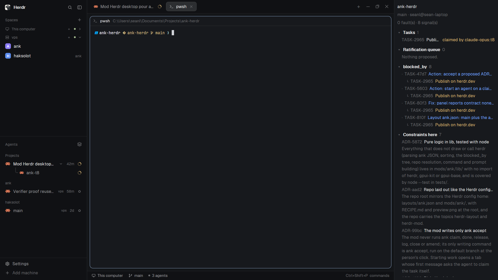

# ank-herdr

A [Herdr](https://herdr.dev) desktop mod and layout for [ank](https://ank.dekrow.com), the stupid coordination tool.

- `mods/ank/`: a panel showing the ank corpus of the repo the focused terminal is in (open and claimed tasks, ratification queue, `blocked_by` tree, constraints binding the focused folder), with actions to start an agent on a claimable task and to accept a proposed ADR or spec.
- `layouts/ank.json`: Herdr's `main` window with the ank panel on the right.

`RECIPE.md` is the brief to build it from scratch.

## Install

Ask an agent running in Herdr:

> Add herdr.dev/layouts/ank-corp/ank-herdr

Or copy the folders by hand into your Herdr home (`~/.config/herdr-app`, or `HERDR_APP_HOME`):

1. Copy `layouts/ank.json` to `layouts/` and `mods/ank/` to `mods/`. If either name is already taken, rename the new one (and the `mod` name in the layout) rather than overwrite.
2. Run `herdr-app check ~/.config/herdr-app/mods/ank`.
3. Switch to it: `herdr-app do layout.switch '{"name":"ank"}'`, or `ctrl-shift-l`. Your own layout stays as it was; deleting the two copies removes it.

To use only the panel in your own layout, copy `mods/ank/` and add a block with `"content": { "mod": "ank" }`.

Requires [ank](https://ank.dekrow.com) (JSON contract 1, tested with 0.9.5) and `git` on the PATH Herdr sees.

## What the mod runs

The mod runs programs on your machine with Herdr's `exec`:

- `ank` (`ank.cmd` on Windows): `ank status`, `find`, `review`, `graph` and `context`, all with `--json`, in the focused repo, whenever the focused folder or the repo's `.ank/` or `refs/ank` change. Its only writing command is `ank accept <id>`, run when you click accept on the default branch. It never claims, logs or closes a task.
- `git rev-parse --path-format=absolute --show-toplevel --git-common-dir`, to find the repo root and the folder holding `refs/ank`.

It watches the repo's `.ank/` and `refs/ank` folders for changes, reaches no network, and reads no files itself. The start action opens a new Herdr tab running the agent you pick, whose first message asks it to claim the task.
