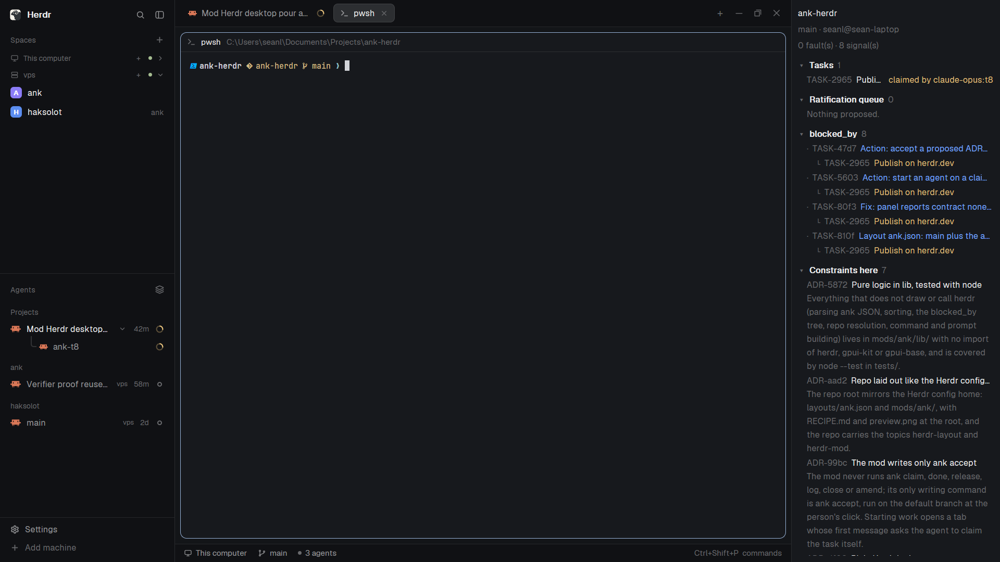

# ank

Herdr's `main` window with one more column on the right: an **ank panel** that
shows the [ank](https://ank.dekrow.com) corpus of the repository the focused
terminal is in. It lists the open and claimed tasks, the ADRs and specs waiting
for ratification, the `blocked_by` tree and the constraints that bind the
focused folder. From it you can start an installed agent on a claimable task,
or accept a proposed ADR or spec when you are on the default branch.

## What you see

Left to right, three columns, with no custom theme: everything is drawn in the
person's Herdr theme and fonts.

1. **Sidebar**, 268px (44 to 480), `chrome` background, exactly as in `main`:
   the Herdr brand row (46px), the spaces list and the agents list sharing the
   height equally (each at least 90px), and the footer (69px) with Settings and
   Add machine.
2. **Work**, the rest of the width, exactly as in `main`: the tab bar (42px),
   the active tab's panes (8px padding and gap, 10px radius, 1px `border`
   outline, 1px `accent` on the focused pane, a 30px pane header always shown),
   the hidden files/changes side panel, and the 28px status bar.
3. **ank panel**, 320px (240 to 640), `surface` background, 10px padding,
   13px text, a 1px `border` divider on its left. Top to bottom:
   - the repo's folder name (`ank-herdr`), in `foreground`;
   - `<branch> · <ank identity>` (`main · seanl@sean-laptop`), in `dim`;
   - `<n> fault(s) · <n> signal(s)` from `ank status`, in `dim`;
   - four collapsible sections, each headed by `▾`/`▸` in `dim`, a title in
     `foreground` at weight 600 and its row count in `dim`, scrolling together
     when they outgrow the panel:
     - **Tasks**: open and claimed tasks of the whole repo. Each row is the
       short id (`TASK-2965`) in `dim`, the title truncated, then
       `claimed by <holder>` in `working` or the state (`open`) in `idle`.
       Empty: "No open or claimed task."
     - **Ratification queue**: proposed ADRs and specs, short id, title, `adr`
       or `spec` in `dim`, and an `accept` control. Empty: "Nothing proposed."
     - **blocked_by**: the whole task graph as a tree, roots first (tasks
       nothing blocks), each blocked task indented 14px per level under every
       task that blocks it, marked `·` at the root and `└` below. Titles are
       `working` for `in_progress`, `done` for done, `foreground` otherwise.
       Empty: "No task in the graph."
     - **Constraints here**: the ratified decisions binding the focused folder
       (`ank context .`): short id and title on one line, the constraint's
       full text below it in `dim`. Empty: "No constraint binds this folder."

## How it behaves

- **Follows focus.** Herdr re-renders mods when focus moves; when the focused
  terminal's folder changes, the panel asks `ank status --json` there. Inside
  an ank repo it shows that repo; in a folder outside any ank repo, on another
  machine or on a mod pane, it keeps the last repo it showed. With no repo
  shown yet it reads "Focus a terminal inside an ank repository." While the
  first reads run it shows "Reading…".
- **Refreshes on change, never on a timer.** It watches the repo's `.ank/`
  folder and the git `refs/ank` folder (the common git dir, so worktrees
  share it). Any claim, done, log or ratification, by anyone in any terminal,
  refreshes the panel within the watch's batch. Changes to `.ank/index.db*`
  alone are ignored: every ank read rewrites that index, the panel's own
  included.
- **Section headers** collapse and expand their section on click.
- **start** (on a Tasks row ank judges ready: neither claimed nor blocked):
  opens a picker under the row, "Looking for agents…" then the installed
  agents Herdr knows, most used first ("No installed agent." when none).
  Choosing one opens a new tab in the repo root named after the task id,
  running that agent with the first message: "Run `ank claim <id>` under your
  own ank identity, then work that task until `ank done` closes it; if you
  cannot finish it, `ank release` it with the reason." The control reads
  `cancel` while the picker is open. The panel itself never claims.
- **accept** (on a queue row): runs `ank accept <id>` in the repo root, only
  when the current branch is ank's default branch. Otherwise the control is
  `dim` and a line under the row says why ("on feat-x: accept runs on main",
  "no branch checked out…", "ank knows no default branch here"). While it runs
  the control reads `accepting…`; the outcome comes as a Herdr notification:
  "Accepted <id>" with ank's line, or "ank refused to accept <id>" with ank's
  error whole. Then the panel reloads.
- **Another ank version.** If ank answers in a JSON contract other than 1 (or
  none), the panel shows only "ank speaks contract <n>; this panel reads
  contract 1".
- Agent statuses are Herdr's own: the sidebar's agents list and the tab bar
  show working, blocked, done and idle as in `main`. The panel colors claimed
  tasks and `in_progress` titles with the theme's `working` color and done
  titles with `done`.

## Built from

- **Layout `layouts/ank.json`**: a file copy of Herdr's shipped
  `layouts/main.json` (not `layout.clone`) with a third child on the root row:
  `{ "id": "ank", "type": "block", "size": { "px": 320 }, "min": 240,
  "max": 640, "content": { "mod": "ank" } }`. The root is a `row`, `titlebar`
  `none`, `background` `canvas`, 1px `border` divider, resizable. The other
  blocks use the shipped mods `workspace-chrome` (brand, and footer with
  `props: { footer: true }`), `spaces`, `agents`, `tabs`, `pane` (pane
  header), `files`, `changes` and `workspace-status`. No `theme`, `colors` or
  `font` anywhere.
- **Mod `mods/ank/`**: `mod.json` is `{ "place": "right", "size": 320 }`, so
  added on its own to another layout it lands on the right. `main.js` is the
  view (a gpui-kit `View`, `v_flex`/`h_flex` from `gpui-base`); `lib/` holds
  every piece of logic with no import of `herdr`, `gpui-kit` or `gpui-base`:
  - `lib/version.js`: the contract it reads, `CONTRACT = 1`.
  - `lib/adapters.js`: `ank <verb> --json` stdout to view models
    (`statusView`, `openTasksView`, `reviewView`, `graphView` as a forest with
    cycles cut per path, `contextView`); throws `IncompatibleContract`.
  - `lib/repo.js`: `resolveRepo` (which repo to show), `ankProgram`
    (`ank.cmd` when `home()` has a drive letter or a backslash, else `ank`),
    `GIT_ARGS`, `touches`, `corpusChanges`, `parentDir`.
  - `lib/sections.js`: the four sections and the reads behind them.
  - `lib/start.js`: `startMessage`, `installedAgents`, `startCommand`,
    `claimableIds`.
  - `lib/accept.js`: `acceptGate`, `acceptCommand`, `acceptOutcome`.
- **`herdr` functions**: `theme`, `focused`, `panes`, `spaces`, `exec`,
  `home`, `watchFolder`, `knownAgents`, `notify`, `run` (the command
  `tab.new {folder, argv, name, task}`).
- **Programs it runs** (`exec`), in the repo root or the focused folder:
  `ank status --json`, `ank find --status open --json`, `ank review --json`,
  `ank graph --json`, `ank context . --json` (focused folder),
  `ank context --json` (root, for what is claimable), `ank accept <id>` on a
  click; and `git rev-parse --path-format=absolute --show-toplevel
  --git-common-dir`. It never reads `.ank/` files or git refs itself, and the
  only ank command that writes is `accept`.
- **Tests**: `node --test tests/` (Node 24) runs `tests/index.js`, which
  imports every `*.test.js`; fixtures in `tests/fixtures/` are real
  `ank --json` captures from ank 0.9.5.
- No art: text and theme colors only.

## Watch out

- **Windows: exec `ank.cmd`, not `ank`.** Herdr's `exec` does no PATHEXT
  lookup, and the extensionless `ank` npm installs is a sh shim: `exec("ank")`
  fails with "program not found". `ank.ps1` fails with os error 193.
- **ank prints errors on stderr.** Outside an ank repo, `ank status --json`
  exits 1 with stdout empty and `{"contract":1,"error":{...}}` on stderr.
  Parse stderr when stdout is empty, or every non-repo folder reads as
  "contract none".
- **No ank verb prints the repo root**: take it, and the common git dir for
  `refs/ank`, from `git rev-parse` once ank has answered there.
- **`refs/ank` does not exist** before the first claim or ratification, and
  `watchFolder` on a missing folder rejects: watch its parent `refs/` and keep
  only batches touching `refs/ank` until it exists.
- **The panel hears itself**: each ank read rewrites `.ank/index.db*`. Without
  dropping those paths, a reload triggers a reload for ever.
- `watchFolder` reports Windows paths as `\\?\C:\...`: normalise before
  comparing.
- `ank find --status open` leaves out `in_progress` tasks: claimed ones come
  from `ank status` (`elsewhere`, and the reader's own claim, which has no
  title there and is drawn with its id).
- Under a claim held by the panel's own ank identity, `ank context` is in
  execution mode and lists no task: no start controls show then.
- The mod's `exec` environment has no `ANK_AGENT`: ank's identity falls back to
  `<user>@<host>`, which is what the second line shows. Fine for reads; an
  accept is recorded under that identity.
- ank 0.9.5 reports no default branch in a repo with no `origin`: accept stays
  disabled there.
- Remote terminals (another machine) are not followed: `watchFolder` watches
  this machine only.
- Assumes `ank` (contract 1, tested with 0.9.5) and `git` on the PATH Herdr
  sees.

## Done when

- `herdr-app check mods/ank` passes, and `node --test tests/` passes.
- `layout.switch {"name":"ank"}` shows `main`'s sidebar, tabs and active tab
  with the ank block on the right, and no `layout.error`.
- Focusing a terminal inside an ank repo shows its folder name, branch and
  identity, and the four sections filled from that repo.
- Focusing a terminal outside any ank repo keeps the last repo shown, never
  "contract none".
- `ank claim <id>` in any terminal of that repo turns the task's row to
  `claimed by <holder>` with no click and no timer.
- A start control opens a tab in the repo root running the chosen agent with
  the claim message; an accept on the default branch notifies "Accepted
  <id>" and the row leaves the queue.
